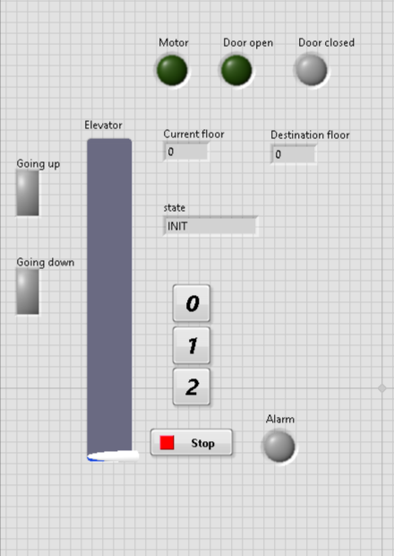
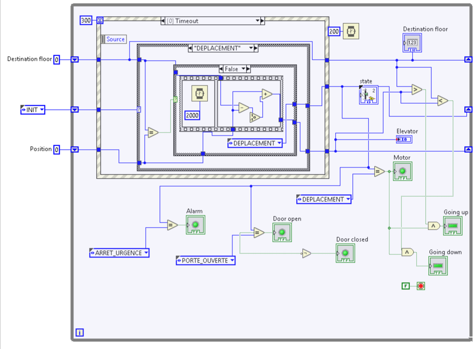

# LabVIEW Elevator Control (State Machine)

A three floor elevator controller and simulator built in **NI LabVIEW 2020**. It uses the classic LabVIEW design pattern **state machine + event structure**: the user presses a floor button, the controller decides the direction, moves the cabin floor by floor, opens and closes the doors, and can go into an emergency stop state. Everything is visible on the front panel with indicators for the motor, the doors, the direction and the alarm.



## Table of contents

1. [Features](#features)
2. [States](#states)
3. [Architecture](#architecture)
4. [Front panel](#front-panel)
5. [Block diagram](#block-diagram)
6. [Project files](#project-files)
7. [Requirements](#requirements)

For a step by step guide, read [TUTORIAL.md](TUTORIAL.md).

## Features

1. Three floors (0, 1, 2) selected with push buttons
2. Elevator shaft display showing the cabin position
3. Current floor and destination floor displays
4. Direction indicators: going up, going down
5. Motor, door open, door closed and alarm indicators
6. State display showing the active state of the controller
7. Emergency stop state and a Stop button to end the program
8. Strict type definition (`State_enum.ctl`) shared by every VI, so all states stay consistent

## States

The states are defined in the type definition `State_enum.ctl`:

| State | Meaning | Indicators |
|---|---|---|
| `INIT` | Start up, variables are reset | All off |
| `ATTENTE` (waiting) | The elevator is idle and waits for a floor request | Door closed |
| `DEPLACEMENT` (moving) | The cabin moves one floor at a time toward the destination | Motor on, going up or going down |
| `PORTE_OUVERTE` (door open) | The cabin reached the destination and the door is open | Door open |
| `PORTE_FERMEE` (door closed) | The door closes before the next request | Door closed |
| `ARRET_URGENCE` (emergency stop) | Everything stops | Alarm on |

Typical cycle:

```
INIT → ATTENTE → DEPLACEMENT → PORTE_OUVERTE → PORTE_FERMEE → ATTENTE
                      ↓
                ARRET_URGENCE
```

## Architecture

| Element | Role |
|---|---|
| While loop | Main loop that runs until Stop is pressed |
| Shift registers | Keep the current **state**, the **position** (current floor) and the **destination floor** between iterations |
| Event structure | Reacts to the floor buttons and the Stop button. Its **timeout of 300 ms** lets the state machine keep running when nobody presses a button |
| Case structure (state machine) | One case per state of `State_enum.ctl`. Each case does its job and returns the next state |
| Moving logic | In `DEPLACEMENT`, the position is compared with the destination. A **2000 ms** wait simulates the travel time of one floor, then the position is increased or decreased by 1. When position equals destination, the next state is `PORTE_OUVERTE` |
| Comparison and Boolean logic | Turn the state and the position into indicator values: motor on when moving, going up when destination is above, going down when below, alarm in emergency |
| Wait (200 ms) | Sets the loop rate |

## Front panel


| Control or indicator | Type | Role |
|---|---|---|
| 0, 1, 2 | Push buttons | Call the elevator to a floor |
| Stop | Button | Ends the program |
| Elevator | Vertical slide indicator | Cabin position in the shaft |
| Current floor, Destination floor | Numeric indicators | Where the cabin is and where it goes |
| state | Enum indicator | Active state |
| Motor, Door open, Door closed, Alarm | LEDs | Status of the elevator |
| Going up, Going down | Indicators | Direction of travel |

## Block diagram



## Project files

```
LabVIEW_Elevator_Control/
|  Elevator_Control.lvproj      LabVIEW project (open this file)
|  elevator_TP.vi               Main VI: final version of the controller
|  State_enum.ctl               Type definition of the states
|  elevator.vi                  Earlier version (three floor buttons named Floor1 to Floor3)
|  elevator_v1_working.vi       First working version
|__ prototype/
|   |  front.vi                 First prototype with French labels (RDC, Etage 1, Etage 2, door blocked)
|__ docs/                       Screenshots
```

## Requirements

1. NI LabVIEW **2020** or newer (the VIs are saved in LabVIEW 2020 format and cannot be opened in older versions)
2. No hardware and no extra toolkit: the elevator is fully simulated

## Author

[achrefslim](https://github.com/achrefslim)
